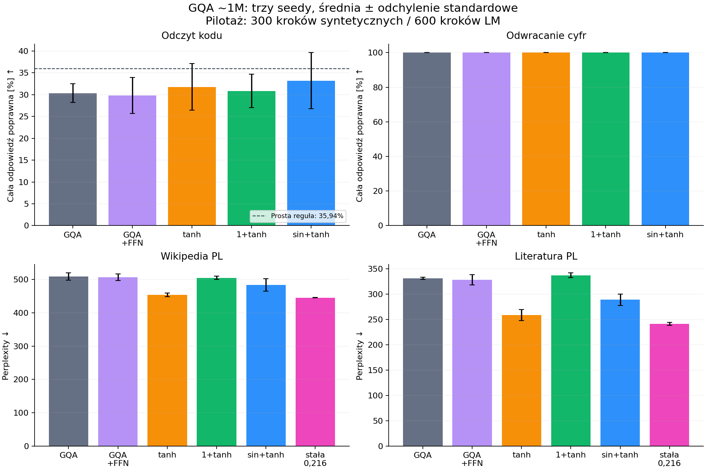
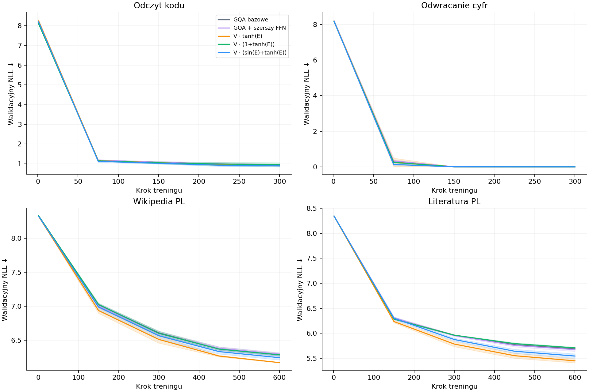

# Czy dodatkowa projekcja E pomaga atencji GQA?

Raport z rzeczywiście wykonanych treningów na CPU. Data: 2026-11-07.

## Wynik w tym budżecie

- Wikipedia PL: spośród pięciu wariantów głównych najniższy średni NLL ma **V · tanh(E)**. Średnie PPL jest o **10.82%** niższe niż bazowe GQA.
- Literatura PL: spośród pięciu wariantów głównych najniższy średni NLL ma **V · tanh(E)**. Średnie PPL jest o **21.90%** niższe niż bazowe GQA.

**Stałe osłabienie V bez E uzyskało niższą średnią perplexity niż tanh(E) na obu korpusach.** Sparowane przedziały różnicy obejmują zero, więc nie ogłaszamy statystycznej przewagi kontroli. Wyniki nie pokazują przewagi E nad prostą kontrolą amplitudy; pokazują, że skala gałęzi atencji jest istotną alternatywną przyczyną poprawy.

To wynik wczesnego uczenia przy jednym harmonogramie lr, a nie ranking architektur po pełnym treningu. Kontrola z równą liczbą wag i osobna kontrola amplitudy są przedstawione niżej.

## Zakres i najważniejsze zastrzeżenie

To pilotaż wczesnego uczenia modelu około 1 mln parametrów. **Nie jest to miniaturowa wierna kopia Qwen3.6-27B ani dowód dotyczący skalowania do 27B.** Nie użyto jego wag. Oficjalny Qwen3.6 ma hybrydowy układ 3× Gated DeltaNet + 1× Gated Attention, encoder obrazu i inne elementy, których nie obejmuje ten eksperyment. Badamy klasyczny dekoder z przyczynową atencją GQA, RMSNorm, RoPE, QK RMSNorm i SwiGLU.

Wzór `sin()` jest niekompletny. Przyjęto **sin(xW_E)**; inny argument oznacza inny eksperyment. Bramkowanie znajduje się na V, przed mnożeniem przez wagi atencji. x oznacza tutaj wyjście pre-RMSNorm bloku. Ta bramka zależy od tokenu źródłowego V; różni się od bramkowania wyniku SDPA zależnego od zapytania.

## Konfiguracja

- 3 bloki, d_model=128, 4 głowy Q, 2 głowy KV, head_dim=32; GQA 2:1.
- Kontekst 64 tokeny, batch 8, słownik 4096, wspólna macierz embeddingów i wyjścia.
- FFN 288; kontrola o równej liczbie parametrów: FFN 309/309/310.
- Bez biasów i dropout. Pełne RoPE, theta=10000. E ma wymiar 128×64 na warstwę; bramka współdzielona przez zapytania korzystające z tej samej głowy KV.
- GQA realizowane przez powtórzenie K/V przed SDPA: poprawność matematyczna GQA, ale bez korzyści pamięciowych wyspecjalizowanego kernela GQA. Brak KV cache.
- Bazowe GQA: **1 004 608** parametrów. Każdy wariant E oraz szerszy FFN: **1 029 184**. Różnica 24 576, czyli 2,446%.
- AdamW, lr maks. 0,002, betas=(0,9;0,95), weight decay=0,1, warmup 10%, cosine do 10% lr, clipping normy gradientu do 1.
- Wszystkie macierze N(0;0,02²), wagi RMSNorm=1. E ma tę samą losową inicjalizację w trzech wariantach. Nie testowano osobno zerowej inicjalizacji residual E.
- Seedy 11/22/33. Inicjalizacja zależy od nazwy parametru: wspólne tensory mają dokładnie te same wartości. Te same minibatch'e dla sparowanych seedów.
- 300 kroków/zadanie syntetyczne, 600 kroków/korpus rzeczywisty. **307 200 tokenów treningowych na jeden trening LM**; to znacznie za mało do oceny docelowego potencjału modelu 1M.
- 5 punktów walidacji; oceniamy końcowy checkpoint, bez wyboru po zbiorze testowym. 16 384 losowo próbkowane tokeny testowe na korpus/run. Okna mogą nakładać się; nie jest to ewaluacja całego korpusu.
- 256 syntetycznych przykładów testowych generowanych autoregresyjnie, z wymaganym poprawnym EOS. Zbiór testowy wspólny dla seedów. Trzy seedy mierzą zmienność treningu, nie pełną niepewność wynikającą z doboru danych.
- Trzy procesy CPU po jednym wątku. Czasy wall-clock obejmują walidację i współdzielenie CPU, więc **nie są wiarygodnym benchmarkiem przyspieszenia sprzętowego**.

## Polski tokenizer i rzeczywiste dane

Wspólny byte-level BPE 4096, NFC, wytrenowany wyłącznie na polskojęzycznych częściach treningowych obu korpusów i treningowych szablonach syntetycznych. Test/val nie uczestniczą w uczeniu BPE. To nowy mały polski tokenizer, nie tokenizer Qwena ani gotowy duży tokenizer Bielika. Pełny alfabet bajtowy zapobiega nieznanym polskim znakom. Przy 50 tys. tokenów sama macierz embeddingów o szerokości 128 miałaby 6,4 mln wag.

**Wikipedia:** radlab/wikipedia-pl, dump 2023-04-01. Pierwsze 5000 artykułów o długości >300 znaków, maksymalnie 30 000 znaków/artykuł. Nie jest to reprezentatywne losowanie całej Wikipedii. Exact dedup po znormalizowanych białych znakach, podział dokumentów hashem SHA256 na 80/10/10. Bez deduplikacji semantycznej i near-duplicate.

**Literatura:** ArielUW/wolnelektury. Trening: Alcott, Andersen, Amicis, Verne, Dumas (6 utworów), walidacja: Prus — „Antek”, test: Conrad — „Lord Jim”, oba tomy. Podział według autorów, bez przechodzenia fragmentów tej samej książki między podziałami. Mała próbka, głównie starszy język i tłumaczenia; wyniku nie należy uogólniać na współczesną polszczyznę. Zachowano teksty korpusu z nagłówkami/metadanymi. Repozytoria, konkretne rewizje, nazwy utworów i hashe plików zapisano w data/sources.json.

Nie trenowano najpierw na syntetyce, a potem na korpusie. **Każde zadanie/korpus trenowane od zera**, żeby nie mieszać transferu z efektem architektury.

## Wyniki końcowe

Niżej średnia ± odchylenie standardowe z 3 seedów. Niższe NLL/perplexity oznacza lepszy wynik. Perplexity porównujemy wyłącznie w obrębie tego samego korpusu i wspólnego tokenizera. Dla syntetyki ważniejsza jest poprawność całej swobodnie wygenerowanej odpowiedzi niż token accuracy obejmująca łatwy EOS.

Liczba tokenów w przygotowanych korpusach (całe podziały, nie liczba tokenów użytych w jednym treningu):

| Korpus | Train | Val | Test |
|---|---:|---:|---:|
| Wikipedia PL | 5331243 | 687042 | 629888 |
| Literatura PL | 893015 | 16342 | 245129 |

### Odczyt kodu

| Wariant | NLL test | Perplexity test | Cała odpowiedź [%] |
|---|---:|---:|---:|
| GQA bazowe | 0.947 ± 0.026 | 2.578 ± 0.066 | 30.339 ± 2.151 |
| GQA + szerszy FFN | 0.928 ± 0.056 | 2.532 ± 0.141 | 29.818 ± 4.103 |
| V · tanh(E) | 0.925 ± 0.010 | 2.522 ± 0.024 | 31.771 ± 5.332 |
| V · (1+tanh(E)) | 0.930 ± 0.083 | 2.540 ± 0.215 | 30.859 ± 3.847 |
| V · (sin(E)+tanh(E)) | 0.877 ± 0.049 | 2.405 ± 0.119 | 33.203 ± 6.430 |

### Odwracanie cyfr

| Wariant | NLL test | Perplexity test | Cała odpowiedź [%] |
|---|---:|---:|---:|
| GQA bazowe | 0.001 ± 0.000 | 1.001 ± 0.000 | 100.000 ± 0.000 |
| GQA + szerszy FFN | 0.000 ± 0.000 | 1.000 ± 0.000 | 100.000 ± 0.000 |
| V · tanh(E) | 0.001 ± 0.000 | 1.001 ± 0.000 | 100.000 ± 0.000 |
| V · (1+tanh(E)) | 0.000 ± 0.000 | 1.000 ± 0.000 | 100.000 ± 0.000 |
| V · (sin(E)+tanh(E)) | 0.000 ± 0.000 | 1.000 ± 0.000 | 100.000 ± 0.000 |

### Wikipedia PL

| Wariant | NLL test | Perplexity test |
|---|---:|---:|
| GQA bazowe | 6.232 ± 0.021 | 508.888 ± 10.702 |
| GQA + szerszy FFN | 6.229 ± 0.019 | 507.138 ± 9.853 |
| V · tanh(E) | 6.118 ± 0.012 | 453.823 ± 5.405 |
| V · (1+tanh(E)) | 6.224 ± 0.009 | 504.857 ± 4.741 |
| V · (sin(E)+tanh(E)) | 6.181 ± 0.040 | 483.862 ± 19.033 |

### Literatura PL

| Wariant | NLL test | Perplexity test |
|---|---:|---:|
| GQA bazowe | 5.803 ± 0.006 | 331.324 ± 2.046 |
| GQA + szerszy FFN | 5.793 ± 0.030 | 328.198 ± 9.849 |
| V · tanh(E) | 5.555 ± 0.042 | 258.778 ± 11.037 |
| V · (1+tanh(E)) | 5.820 ± 0.014 | 337.016 ± 4.646 |
| V · (sin(E)+tanh(E)) | 5.666 ± 0.039 | 288.893 ± 11.222 |

Dodatkowa kontrola syntetyczna: wybieranie najczęstszej cyfry bez rozumienia pytania daje **35,94%** na tym samym teście odczytu kodu (92/256). Wynik na tym poziomie nie świadczy o opanowaniu przypisania osoba→kod. Zwykłe skopiowanie cyfr bez odwrócenia daje 0/256 na użytym teście odwracania.

## Sparowane różnice NLL

Ujemna różnica oznacza poprawę względem wskazanej kontroli. Orientacyjny 95% przedział t-Studenta z 3 sparowanych seedów, df=2; szeroki i wrażliwy na założenie normalności. Bez korekty wielokrotnych porównań. To opis niepewności pilotażu, nie potwierdzenie odkrycia.

| Zadanie | E | Δ vs bazowe [95% CI] | Δ vs równe parametry [95% CI] |
|---|---|---:|---:|
| Odczyt kodu | V · tanh(E) | -0.0219 [-0.0928, +0.0489] | -0.0028 [-0.1379, +0.1323] |
| Odczyt kodu | V · (1+tanh(E)) | -0.0170 [-0.2063, +0.1722] | +0.0021 [-0.2447, +0.2489] |
| Odczyt kodu | V · (sin(E)+tanh(E)) | -0.0700 [-0.1826, +0.0426] | -0.0509 [-0.1502, +0.0485] |
| Odwracanie cyfr | V · tanh(E) | -0.0001 [-0.0010, +0.0008] | +0.0000 [-0.0005, +0.0005] |
| Odwracanie cyfr | V · (1+tanh(E)) | -0.0002 [-0.0007, +0.0004] | -0.0000 [-0.0001, +0.0001] |
| Odwracanie cyfr | V · (sin(E)+tanh(E)) | -0.0002 [-0.0007, +0.0003] | -0.0001 [-0.0003, +0.0001] |
| Wikipedia PL | V · tanh(E) | -0.1144 [-0.1958, -0.0331] | -0.1110 [-0.1873, -0.0347] |
| Wikipedia PL | V · (1+tanh(E)) | -0.0078 [-0.0370, +0.0213] | -0.0044 [-0.0293, +0.0205] |
| Wikipedia PL | V · (sin(E)+tanh(E)) | -0.0508 [-0.2012, +0.0996] | -0.0474 [-0.1938, +0.0991] |
| Literatura PL | V · tanh(E) | -0.2477 [-0.3383, -0.1572] | -0.2380 [-0.2693, -0.2066] |
| Literatura PL | V · (1+tanh(E)) | +0.0170 [-0.0142, +0.0482] | +0.0267 [-0.0461, +0.0996] |
| Literatura PL | V · (sin(E)+tanh(E)) | -0.1375 [-0.2290, -0.0461] | -0.1278 [-0.2089, -0.0466] |

## Interpretacja mechanizmu

Dla z=xW_E:

| Bramka | Zakres | g(0) | g′(0) | Konsekwencja |
|---|---|---:|---:|---|
| tanh(z) | (-1,1) | 0 | 1 | może odwracać znak i na starcie tłumi V |
| 1+tanh(z) | (0,2) | 1 | 1 | zachowuje bezpośrednią ścieżkę V; przy E=0 odtwarza bazową atencję |
| sin(z)+tanh(z) | ograniczona przez (-2,2) | 0 | 2 | większe nachylenie przy zerze i niemonotoniczność; brak składnika tożsamościowego |

Nie tylko liczba parametrów odróżnia te funkcje: zmieniają skalę wyjścia i gradientów. Dlatego sam wynik nie izoluje np. „korzyści z sinusoidy”. Potrzebne byłyby ablacje wyrównujące początkową wariancję bramki oraz osobne strojenie learning rate z jednakowym budżetem dla wszystkich wariantów.

Zero-inicjalizacja E jest naturalną dodatkową ablacją dla 1+tanh. Dla tanh i sin+tanh wyzerowałaby początkowo V_mod, blokując w pierwszym kroku gradienty części gałęzi atencji (ale nie samego E). W wykonanych treningach E nie było zerowane.

W literaturze istnieją pozytywne wyniki dla bramkowania **wyjścia SDPA sigmoidem** zależnym od zapytania. Nie dowodzą one przewagi konkretnego bramkowania V z tanh lub sin. Kontrola sigmoid-after-SDPA nie została tutaj uruchomiona.

## Co ten test sprawdza, a czego nie

Wykonano 60 treningów głównych i 6 dodatkowych kontroli skali; sprawdzono kauzalność, przepływ skończonych gradientów, dokładną liczbę parametrów kontroli i tożsamość residual gate przy E=0. Zadania syntetyczne mają rozłączne przykłady train/val/test według hasha całego przykładu. BPE zapisano i użyto wspólnie we wszystkich wariantach.

Nie sprawdzono pełnej zbieżności, modelu hybrydowego Qwena, długiego kontekstu, większego modelu, zmiany proporcji Q/KV, transferu do zadań klasyfikacji, benchmarków wiedzy ani kosztu zoptymalizowanych kerneli GPU. Brak dowodów na konkretny procent przyspieszenia uczenia. Same wyniki po tak małej liczbie tokenów nie uzasadniają wdrożenia E do dużego modelu.

Do mocniejszej weryfikacji: przynajmniej 20–50 mln tokenów na trening LM, większa i losowana próbka polskich tekstów, ≥5 seedów, dłuższy kontekst, wspólne strojenie lr oraz ablacje inicjalizacji/skali i sigmoid-after-SDPA. To propozycja kolejnego eksperymentu, nie wynik wykonany tutaj.

## Powtarzalność

`python prepare.py` pobiera przypięte rewizje danych. Pakiet zawiera tokenizer i manifest danych. Najpierw uruchom `python prepare.py`, następnie `python run_all.py`; tablice tokenów powstaną automatycznie. Same teksty i tablice tokenów nie są dołączone. `checks.py` sprawdza implementację, `analyze.py` generuje raport. `results_final/` zawiera surowe wyniki każdego treningu i parametry środowiska. Brak zapisanych wag końcowych — odtworzenie modeli wymaga ponownego treningu. Nie utożsamiać innych katalogów z wynikami finalnymi; pakiet obejmuje wyłącznie finalny eksperyment.

Źródła:

- https://huggingface.co/Qwen/Qwen3.6-27B — architektura referencyjna; pobrana konfiguracja w qwen_reference_config.json.
- https://huggingface.co/datasets/radlab/wikipedia-pl — karta: CC BY 4.0, dump Wikipedii.
- https://huggingface.co/datasets/ArielUW/wolnelektury — teksty Wolnych Lektur, autorzy/tytuły/tłumacze zachowani w plikach. Zob. warunki użycia https://wolnelektury.pl/media/chunks/attachment/Ksi%C4%99ga_atrybucji_q0K6Cc5.pdf .
- https://arxiv.org/abs/2505.06708 — Gated Attention for Large Language Models, Qiu i in.; odmienny mechanizm bramkowania.

## Dodatkowa kontrola amplitudy V (eksploracyjna)

Dodana po obejrzeniu wstępnego wyniku tanh na Wikipedii: szeroki FFN o tej samej liczbie parametrów co E, bez E, ze stałym mnożnikiem V=0,216. Ta liczba jest zaokrągleniem początkowego RMS tanh(z)≈0,2158735 dla z~N(0;128·0,02²), a nie wynikiem strojenia na walidacji. Wyrównuje przybliżoną początkową amplitudę, ale nie średnią, znaki ani adaptacyjność bramki. Identyczny protokół 600 kroków, 3 seedy. Nie jest częścią pierwotnie ustalonego zestawu porównań.

| Korpus | PPL stała skala 0,216 | PPL tanh(E) | Sparowane ΔNLL tanh − stała [95% CI] |
|---|---:|---:|---:|
| Wikipedia PL | 445.601 ± 0.409 | 453.823 ± 5.405 | +0.0182 [-0.0120, +0.0484] |
| Literatura PL | 241.261 ± 2.820 | 258.778 ± 11.037 | +0.0695 [-0.0182, +0.1572] |
